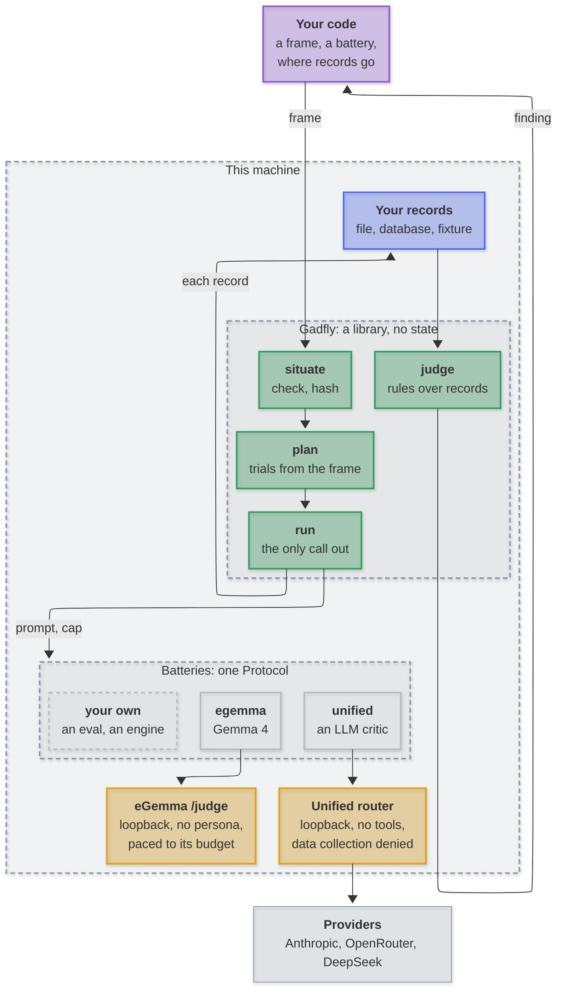
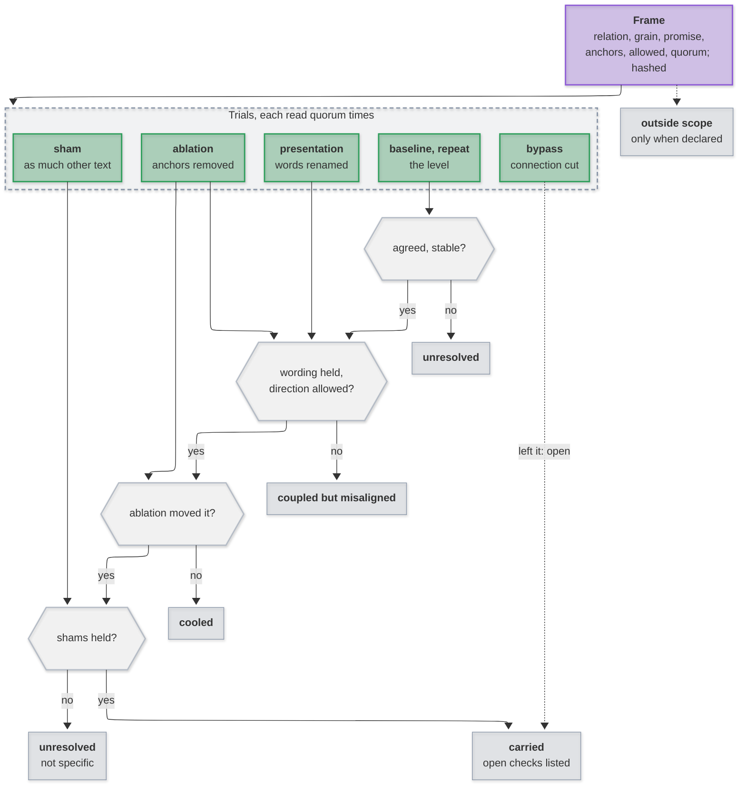

# Gadfly

Is a premise **load-bearing**? Declare the relation, its grain and the promise
a recipient needs; Gadfly removes or changes it under fixed interventions, has
a scorer read each trial, and reads the verdict by fixed rules. The method:
[When meaning is load-bearing](https://github.com/mirzahusadzic/mirzahusadzic#when-meaning-is-load-bearing).





## Frame

| Formalization | Field | What you write |
|---|---|---|
| relation $I$, locus $v$, body $B$ | `relation`, `locus`, `body` | the premise, where it acts, the spans it lives in |
| role $r$, grain $g$, purpose $P$ | `role`, `grain`, `purpose` | whose reading, at which unit, for what |
| trajectory $T$, baseline $B_0$ | `trajectory`, `baseline` | the path to the recipient; everything pinned |
| crossing $C$, promise $p$ | `crossing`, `promise` | the boundary, and what must cross it |
| anchors $A$, observation $o_p$ | `anchors`, `observe` | spans the relation rests on; labels (and their order) |
| test domain $X$, interventions $\Delta_I$ | `inputs`, `interventions` | the inputs; the trials below |
| $\simeq_p$, $E_{p,\delta}$ | `observe.labels`, `allowed` | same label, same observation; what ablation may produce |
| standing $\sigma$ | `standing` | `quorum` runs a trial, `agree` for a level, `stable` |

Hashed whole: change any coordinate, the grain included, and it is another frame.

| Trial | Changes | Settles |
|---|---|---|
| `baseline`, `repeat` | nothing | the level, and whether it holds |
| `ablation` | anchors removed | required influence |
| `cumulative` | anchors and what they fell back on | support carried elsewhere |
| `sham` | as much unanchored text, same kind | specificity |
| `presentation` | words renamed consistently | presentation invariance |
| `bypass` | the connection cut | no hidden fallback |

## Use

```python
import json
from pathlib import Path

from examples.refund import RuleReader  # or your own battery
from gadfly.pipeline import calls_needed, judge, run, situate
from gadfly.types import Budget

frame = situate(json.loads(Path("examples/refund.json").read_text()))
kept = []  # your state, kept your way
result = run(frame, RuleReader(), Budget(calls=calls_needed(frame)), on_record=kept.append)
[finding] = judge(frame, kept)
print(finding.category, finding.evidence)
```

| Example | Shows | Calls |
|---|---|---|
| [`refund.py`](examples/refund.py) | presentation tells a phrase matcher (misaligned) from a rule reader (carried) | none |
| [`refund_live.py`](examples/refund_live.py) | the same frame read by a live critic | 21 a model |
| [`after_the_poem.py`](examples/after_the_poem.py) | a study's retained sessions reach every published category ([After the Poem](https://github.com/mirzahusadzic/after-the-poem)) | none |

All three run as tests.

## Batteries

```python
class Battery(Protocol):
    name: str

    def check(self, frame: Frame) -> None: ...  # refuse before any call
    def observe(self, frame: Frame, prompt: str, max_output_tokens: int) -> Observation: ...
```

| Battery | Reads with | Guarantees |
|---|---|---|
| `unified` | an LLM through the [unified model router](https://github.com/mirzahusadzic/codex-unified-model-router): `anthropic/`, `openrouter/`, `deepseek/` | loopback, no tools, `data_collection: deny` unless the frame names the model under `trainsOnInputs`; OpenAI slugs refused (need Codex sign-in) |
| `egemma` | Gemma 4 through [eGemma](https://github.com/mirzahusadzic/egemma)'s `/judge` | loopback, no persona, no cache, paced to `GET /rate-limits` |
| your own | an evaluation, or a deterministic engine (`quorum: 1`) | yours |

Critics answer JSON to a schema, `{"label": ...}` by default. Your own critic
keeps its schema and points at the label:

```json
"battery": {"kind": "unified", "model": "anthropic/claude-sonnet-5-5", "reasoning": "low",
            "output": {"schema": {"type": "object", "properties": {"review": {"type": "object"}}},
                       "label": "/review/verdict"}}
```

## Runs and records

- `run` never starts a call the `Budget` cannot cover, stops between calls on `cancelled()`, and hands each `Record` to `on_record` as it is made.
- A failed or unreadable answer is an opening, never a guessed label.
- `judge` reads only records the plan could have made: this frame, its trials and bodies, runs within the quorum, each once.

## Development

```
uv sync
uv run pytest            # the After the Poem replay runs when GADFLY_ATP_PLANS names its plans
uv run ruff check . && uv run ruff format --check .
```
