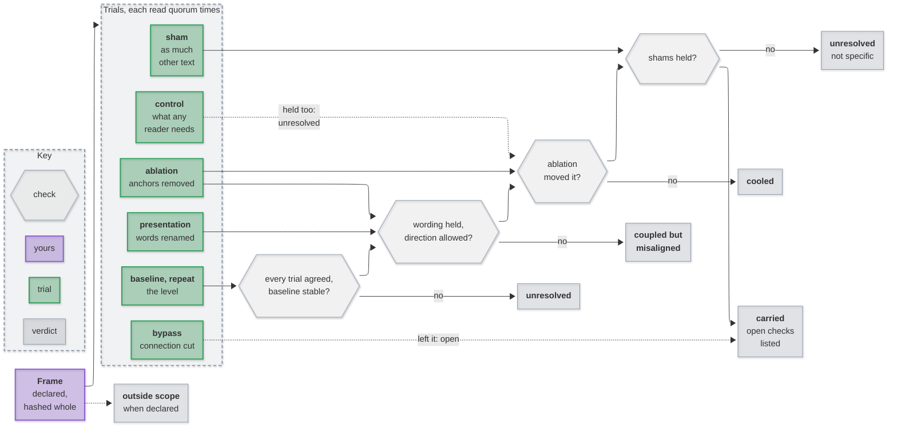

# Gadfly

Is a premise **load-bearing**? Declare the relation, its grain and the promise
a recipient needs; Gadfly removes or changes it under fixed interventions, has
a scorer read each trial, and reads the verdict by fixed rules. The method:
[When meaning is load-bearing](docs/load-bearing.md).

## Use

<!-- --8<-- [start:use] -->
```python
import json
from pathlib import Path

from examples.refund import RuleReader  # or your own battery
from gadfly.pipeline import calls_needed, judge, run, situate
from gadfly.types import Budget

frame = situate(json.loads(Path("examples/refund.json").read_text()))
kept = []  # your state, kept your way
result = run(frame, RuleReader(), Budget(calls=calls_needed(frame)), on_record=kept.append)
[finding] = judge(frame, kept)
print(finding.category, finding.evidence)
```

Several inputs: `overall(judge(frame, kept))` reads one category over them. A run
that stopped is finished with `run(..., kept=kept)`: only the calls not yet made
are made.
<!-- --8<-- [end:use] -->

## How a verdict is read

<!-- --8<-- [start:framework] -->


<p align="center"><em>Each trial feeds the check it settles; the first “no” names the verdict. Dotted: left open, or only when declared.</em></p>
<!-- --8<-- [end:framework] -->

## Frame

<!-- --8<-- [start:frame] -->
| Formalization | Field | What you write |
|---|---|---|
| relation $I$, locus $v$, body $B$ | `relation`, `locus`, `body` | the premise, where it acts, the spans it lives in |
| role $r$, grain $g$, purpose $P$ | `role`, `grain`, `purpose` | whose reading, at which unit, for what |
| trajectory $T$, baseline $B_0$ | `trajectory`, `baseline` | the path to the recipient; everything pinned (text or object) |
| crossing $C$, promise $p$ | `crossing`, `promise` | the boundary, and what must cross it |
| anchors $A$, observation $o_p$ | `anchors`, `observe` | spans the relation rests on; `labels`, `instruction`, and `order` for ordered labels |
| test domain $X$, interventions $\Delta_I$ | `inputs`, `interventions` | the inputs, each `{id, text}`; the trials below |
| $\simeq_p$, $E_{p,\delta}$ | `observe.labels`, `allowed` | same label, same observation; what `ablation` may produce (labels, or `lower`/`higher` along `order`), and the opening `bypass` must expose |
| standing $\sigma$ | `standing` | `quorum` runs a trial, `agree` for a level; `stable` (with `repeat`) |
| materialization | `materialized` | `true` when the observation is the form the recipient receives |
| outside scope | `outsideScope` | the receiving owner's exclusion, in words |
<!-- --8<-- [end:frame] -->

Hashed whole: change any coordinate, the grain included, and it is another frame.
Every key is checked before a call: an unknown one, or a trial that could change
nothing, is refused.

<!-- --8<-- [start:trials] -->
| Trial | Changes | Settles |
|---|---|---|
| `baseline`, `repeat` | nothing | the level, and whether it holds |
| `ablation` | anchors removed | required influence |
| `cumulative` | anchors and what they fell back on | support carried elsewhere |
| `sham` | as much unanchored text, same kind (`true`, or `{"draws": n}`) | specificity |
| `presentation` | words renamed consistently, in one pass | presentation invariance |
| `bypass` | the connection cut | no hidden fallback: with `allowed.bypass`, only at that opening |
| `control` | what any reader needs | that the scorer can move: a cooled verdict needs it |

What the trials leave unsettled is listed beside the category as an open check.
<!-- --8<-- [end:trials] -->

## Batteries

<!-- --8<-- [start:protocol] -->
```python
class Battery(Protocol):
    name: str

    def check(self, frame: Frame) -> None: ...  # refuse before any call
    def observe(self, frame: Frame, prompt: str, max_output_tokens: int) -> Observation: ...
```
<!-- --8<-- [end:protocol] -->

<!-- --8<-- [start:batteries] -->
| Battery | Reads with | Guarantees |
|---|---|---|
| `unified` | an LLM through the [unified model router](https://github.com/mirzahusadzic/codex-unified-model-router): `anthropic/`, `openrouter/`, `deepseek/` | loopback, no tools, `data_collection: deny` unless the frame names the model under `trainsOnInputs`; OpenAI slugs refused (need Codex sign-in); `endpoints` pins OpenRouter endpoints; records the model and endpoint that served |
| `egemma` | Gemma 4 through [eGemma](https://github.com/mirzahusadzic/egemma)'s `/judge` | loopback, no persona, no cache, paced to `GET /rate-limits`; records the `model` and `revision` that served, and holds them when the frame names them |
| your own | an evaluation, or a deterministic engine (`quorum: 1`) | yours; its `name` is the frame's `battery.kind` |
<!-- --8<-- [end:batteries] -->

<!-- --8<-- [start:adapter] -->
Critics answer JSON to a schema, `{"label": ...}` by default. Your own critic
keeps its schema and points at the label:

```json
"battery": {"kind": "unified", "model": "anthropic/claude-sonnet-5-5", "reasoning": "low",
            "output": {"schema": {"type": "object", "properties": {"review": {"type": "object"}}},
                       "label": "/review/verdict"}}
```
<!-- --8<-- [end:adapter] -->

## Examples

<!-- --8<-- [start:examples] -->
| Example | Shows | Calls |
|---|---|---|
| `examples/refund.py` | presentation tells a phrase matcher (misaligned) from a rule reader (carried) | none |
| `examples/refund_live.py` | the same frame read by a live critic | 21, to a model |
| `examples/review_handoff.py` | the worked example of *When meaning is load-bearing*, failed check to review handoff: one system carries the finding and the grant, a "fix ready" summary cools both, one that drops its openings is misaligned, a lost record is unresolved | none |
| `examples/after_the_poem.py` | a study's retained sessions reach every published category ([After the Poem](https://github.com/mirzahusadzic/after-the-poem)) | none |

All run as tests.
<!-- --8<-- [end:examples] -->

## Docs

`uv run --group docs mkdocs serve`: architecture, framework, batteries, examples and the API reference.

## License

Code: Apache-2.0. The text of `docs/load-bearing.md`: © 2026 Mirza Husadzic,
[CC BY 4.0](LICENSES/CC-BY-4.0.txt).

## Development

```
uv sync
uv run pytest            # the After the Poem replay runs when GADFLY_ATP_PLANS names its plans
uv run ruff check . && uv run ruff format --check .
```
