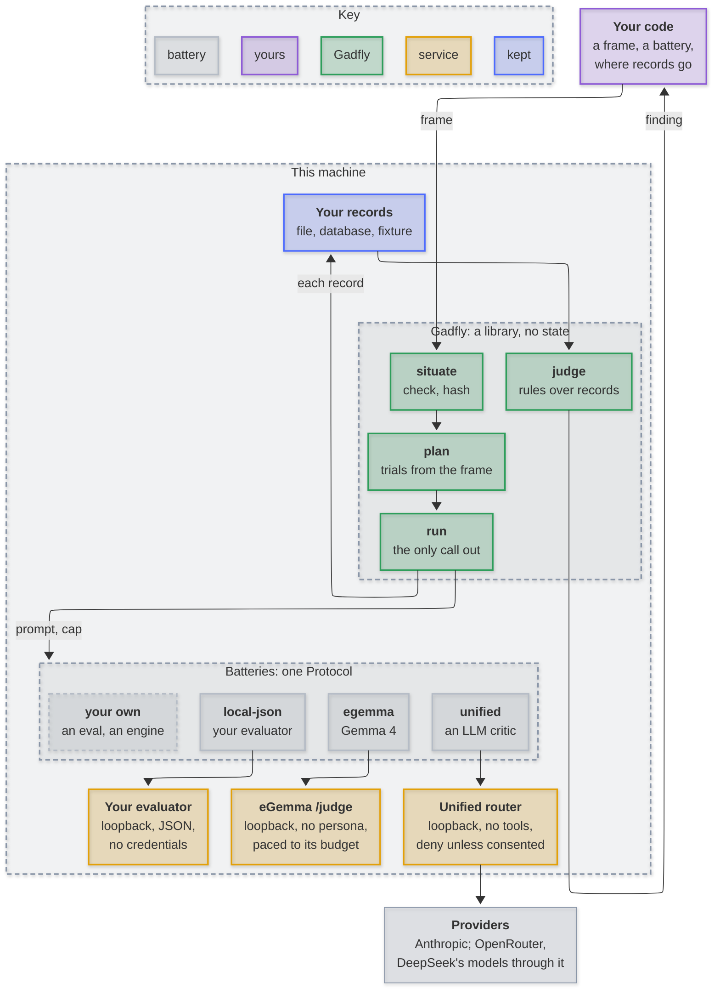

# Architecture and limits

Gadfly is a library with no state: your code hands it a frame, it calls one
battery, and every record goes back to you as it is made. The chart shows
where each boundary is, and the sections below read it and list what a verdict
does not claim.

<em>Gadfly keeps no state: each record goes to you as it is made, and judge reads them back.
The shipped batteries use the loopback paths shown; your own battery is arbitrary code. One battery serves a run.</em>

---

### What the code guarantees

Three promises hold whatever battery serves the run.

- **A run spends only what it may:** `run` never starts a call the `Budget`
  cannot cover, stops between calls on `cancelled()`, and hands each `Record`
  to `on_record` as it is made.
- **A failure is an opening:** a failed or unreadable answer becomes an
  opening, never a guessed label.
- **A verdict reads only its own records:** `judge` reads only records the
  plan could have made: this frame, its trials and bodies, runs within the
  quorum, each once.

---

### Reading the chart

The chart is about **boundaries**, which a table cannot show as directly:

| Boundary | What crosses it | What the caller keeps |
|---|---|---|
| your code → `situate` | one JSON declaration | the frame and its hash |
| `run` → batteries | one prompt and output cap | the battery gets the frame and the prompt, never the trial's id |
| `run` → your records | one immutable `Record` at a time | the only durable state in the workflow |
| records → `judge` | saved evidence, not a live service | verdicts can be recomputed without another call |
| shipped batteries → local services | schema-constrained requests to loopback | tokens and credentials stay out of observations |

The shipped batteries keep the loopback, no-proxy and no-redirect rules. The
`Battery` protocol does not, so a battery of your own may do anything its code
does.

---

### Current limits

A verdict is narrower than it may look. Read these before relying on one.

- **A category is a reading, not a proof:** it is a fixed-rule reading of
  observations under one frame, not proof of causality and not a probability.
  A result is about the declared frame, inputs, scorer and encounter, not a
  general quality score.
- **Read the policy before the category:** under the default
  `carriage: all-checks`, a category is named only once the checks it needs
  have passed. `carriage: listed` names it with the open checks beside it, as
  After the Poem's study reads them.
- **Declarations are not inspections:** `materialized: true` is the author's
  declaration, and Gadfly does not inspect the receiving document, field,
  program or state. `scopeCheck` records the owner's check of an exclusion,
  which Gadfly does not make itself.
- **Records are yours to keep and trust:** traceability rests on records the
  caller keeps, which Gadfly neither authenticates nor signs. `judge` does
  not check a record's prompt digest against the current prompt, so a replay
  may keep its study's own; a run resumed from kept records does, since they
  are its own. Keep records somewhere you trust, with the run details you
  need.
- **A battery tests what it is:** a deterministic battery tests the frame and
  its mechanics, not a model. A sampled live critic tests that model and
  endpoint at one encounter, not a provider's general policy.

---

### Limits in practice

The examples showed what using Gadfly asks of its author, beyond what the code
guarantees.

- **It shows that, not why:** a cooled verdict says the anchor is not what
  decides, not whether a training habit or another line does.
  [The cumulative trial](examples/cumulative.md) narrows it down.
- **A verdict is only as good as its frame:** the author names the anchor,
  the line that makes it apply and a fair control, and a frame built wrong
  reads wrong, as [A frame built wrong](examples/built-wrong.md) shows.
  Predictions written before the first call keep a frame from being shaped by
  its result.
- **Answers are labels:** the reader picks one of a few fixed labels, so a
  decision given as nuanced free text has to be cut down to fit.
- **Strict, so often unresolved:** one trial without an agreed level makes a
  finding unresolved, and one such input makes the frame's overall category
  unresolved. Unresolved names the open check; it is not a failure.
- **Thin statistics:** a trial's level is `agree` of `quorum` calls, 4 of 5
  in every example, with no confidence range. A frame that names no
  temperature gets the battery's default, and its records do not say what that
  was.
- **It cuts, renames and moves, never adds:** a decision that follows from a
  default, such as access denied because nothing grants it, cannot be moved by
  cutting evidence, as [Several inputs](examples/inputs.md) shows.
- **It reads what a decision rests on, not whether it is right:** blocking a
  customer without the line saying they signed may well be good caution, as in
  [Bypass](examples/bypass.md).
- **The words are the essay's:** carried, cooled, crossing and locus mean
  something narrower here, and the [Glossary](glossary.md) defines each.

---

### Nearest neighbours

Context-attribution tools for AI answers, such as ContextCite, also cut
sources to see what an answer relies on. Gadfly's own part is the promise
declared before the run, the fixed rules, the list of what is still open, and
records anyone can read back.
