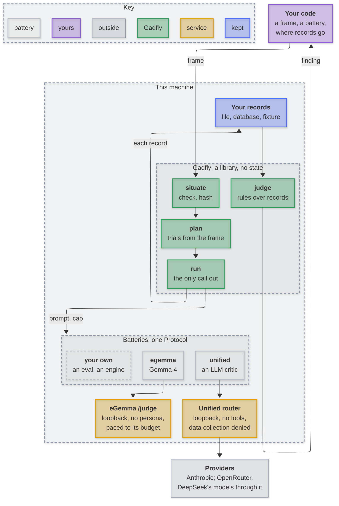

# Architecture

<em>Gadfly keeps no state: each record goes to you as it is made, and judge reads them back.
Batteries reach only this machine; providers only through the router.</em>

- `run` never starts a call the `Budget` cannot cover, stops between calls on `cancelled()`, and hands each `Record` to `on_record` as it is made.
- A failed or unreadable answer is an opening, never a guessed label.
- `judge` reads only records the plan could have made: this frame, its trials and bodies, runs within the quorum, each once.
